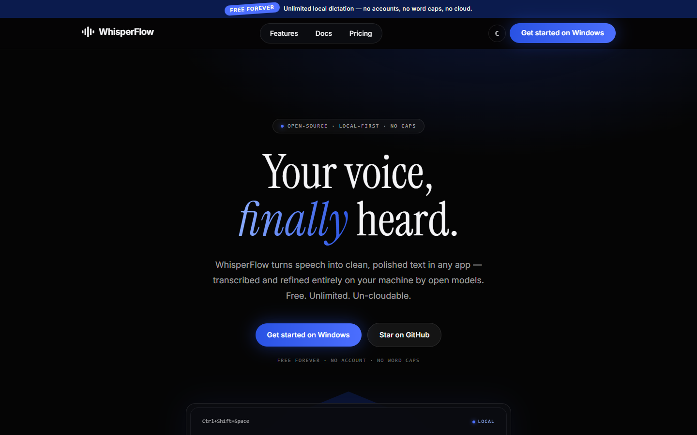
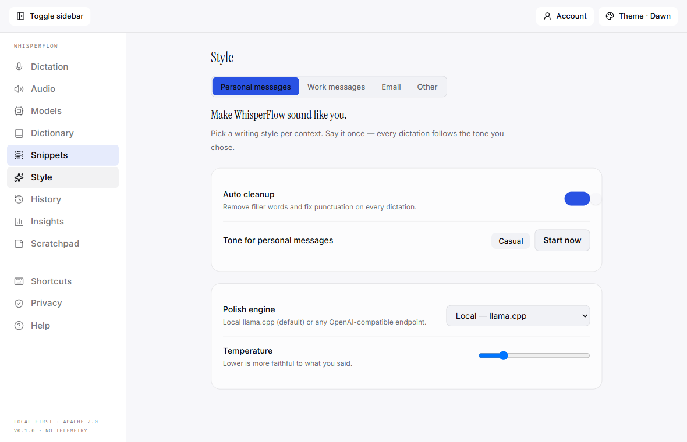
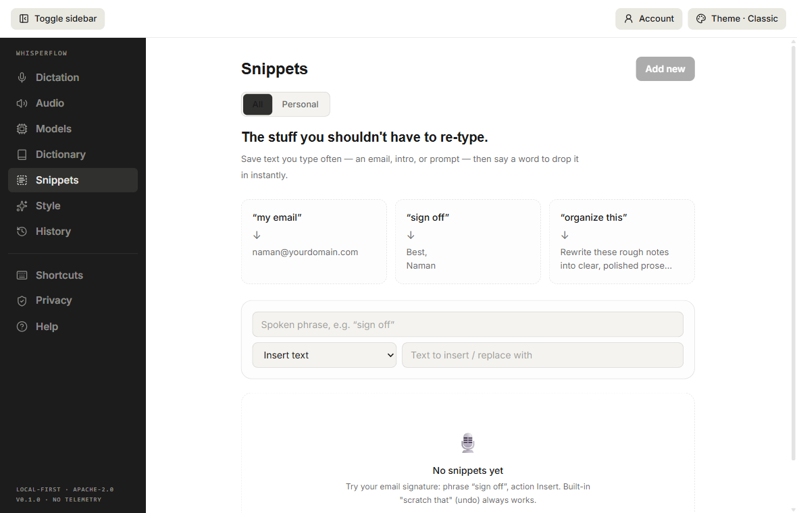
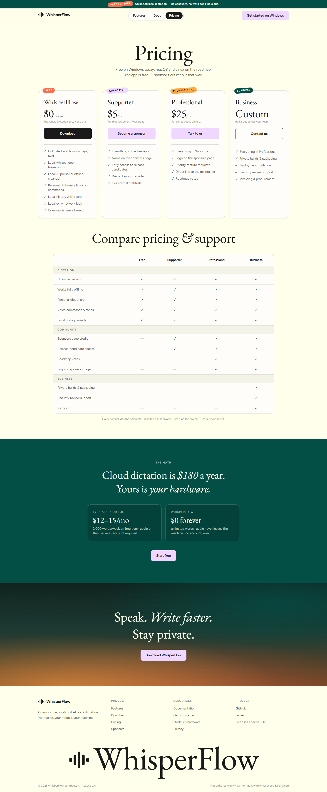

<p align="center">
  
</p>

<h1 align="center">WhisperFlow</h1>

<p align="center">
  
</p>

<p align="center">
  <strong>Open-source, local-first AI voice dictation.<br/>Your voice, your models, your machine.</strong>
</p>

<p align="center">
  <a href="#license"></a>
  <a href="https://namandhakad712.github.io/whisperflow/"></a>
  <a href="../../actions"></a>
  
  
</p>

---

Hold a key, speak naturally, and get polished text injected into any app — transcribed and
refined **entirely on your machine** by open models from HuggingFace. No word caps. No cloud.
No accounts. No telemetry.

> WhisperFlow is an independent, clean-room project. Not affiliated with Wispr Inc., OpenAI,
> Meta, or the Qwen team. All code, art, and copy here are original.

## Screenshots

| Home (Nocturne — dark) | Nocturne Dawn (light) |
| --- | --- |
|  |  |

| Snippets board | Pricing |
| --- | --- |
|  |  |

**Live site:** <https://namandhakad712.github.io/whisperflow/>

## Why WhisperFlow exists

Commercial dictation tools stream your voice to their servers and meter your words
(2,000 words/week on free tiers is common). WhisperFlow deletes that model:

- 🖥️ **Local-first** — whisper.cpp transcription + llama.cpp polish run on your hardware; models download once from HuggingFace and work offline forever
- ♾️ **Unlimited** — no caps, no tiers, no accounts; your hardware is the only meter
- 🔓 **Freedom** — Apache-2.0, modular engine (`@whisperflow/engine` has zero Electron imports — Tauri/CLI hosts are drop-in), pluggable STT/polish providers, BYO OpenAI-compatible endpoint
- 🔒 **Private** — flip the local-only lock and the app *cannot* make a network call. Zero telemetry, verifiable in source

## Features

- Global hotkey (default `Ctrl+Shift+Space`) + floating overlay with live waveform and streaming partials
- AI polish with tone presets, custom instructions, and per-context styles (Personal / Work / Email)
- Personal dictionary with fuzzy post-STT correction + prompt injection
- Voice snippets & commands ("scratch that" ships built-in)
- Insights from local history (words, streaks, 7-day bars) + local Scratchpad notes
- Hardware-tiered model manager with resumable HuggingFace downloads
- Three full design systems: **Nocturne** (dark) · **Dawn** (light) · **Classic** (reference-measured)
- Onboarding wizard with a full ASR configuration board (language, model, sensitivity, polish)

## Quickstart

Requires Node ≥ 20 (Windows today; macOS/Linux packaging on the roadmap).

```bash
git clone https://github.com/namandhakad712/whisperflow.git
cd whisperflow
npm install
npm run dev        # desktop app — onboarding walks you through models
npm run dev:website
```

First launch: allow the mic → configure your speech engine → download models
(≈500 MB, resumable) → hold the hotkey and speak. `Esc` always cancels.

## Monorepo layout

| Path | What |
| --- | --- |
| `apps/desktop` | Electron app: main, preload, React UI (10+ tabs, 3 themes) |
| `apps/website` | Astro marketing + docs site (GitHub Pages) |
| `packages/shared` | Typed IPC contract, zod config schema, state machine |
| `packages/engine` | The dictation engine — host-agnostic, pure TS |
| `docs/` | Architecture, ADRs, parity matrix, reference-app analysis, research |

Read [`docs/ARCHITECTURE.md`](docs/ARCHITECTURE.md) — the binding contract — and
[`docs/analysis/app-ui/PARITY-MATRIX.md`](docs/analysis/app-ui/PARITY-MATRIX.md) for the
verified feature scoreboard.

## Documentation

- [Architecture](docs/ARCHITECTURE.md) · [Roadmap](docs/ROADMAP.md) · [ADRs](docs/adr/)
- [Security policy](SECURITY.md) · [Changelog](CHANGELOG.md) · [Code of Conduct](CODE_OF_CONDUCT.md)
- [Live docs on the site](https://namandhakad712.github.io/whisperflow/docs/)

## Contributing

See [CONTRIBUTING.md](CONTRIBUTING.md). Clean-room policy: never submit code, assets, or copy
derived from proprietary products.

## Support the project

⭐ Star the repo · 💛 GitHub Sponsors (activates with the first release) · 🏢 see
[Pricing](https://namandhakad712.github.io/whisperflow/pricing/) for support tiers

## License

[Apache-2.0](LICENSE) © WhisperFlow contributors. Whisper models are used via whisper.cpp (MIT)
and llama.cpp (MIT). This project is not affiliated with OpenAI, Meta, or the Qwen team.
