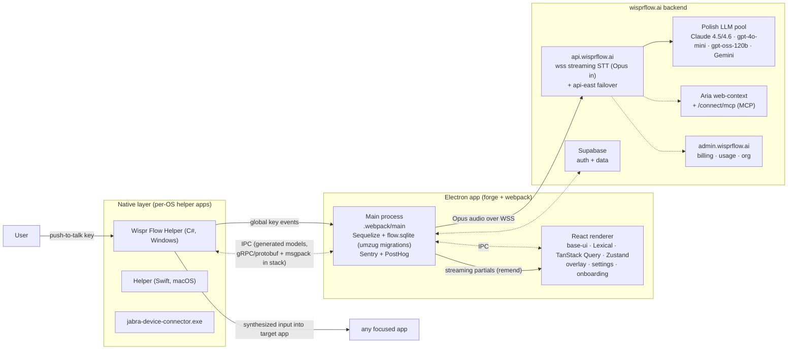

# Wispr Flow — Reconstructed Architecture (v1.6.1264, Windows)

Component inventory derived from static analysis (see `app-analysis.md` for evidence).
Shapes are inferred from artifacts, not from execution.

## Component inventory

| Layer | Component | Technology (observed) |
| --- | --- | --- |
| Packaging | electron-forge, webpack, Squirrel updater, S3 publisher | shipped scripts + install root |
| Renderer | overlay/settings/onboarding React app | base-ui, floating-ui, Lexical, TanStack Query, Zustand, react-i18next, SCSS modules |
| Main | dictation orchestration, SQLite (Sequelize/umzug), telemetry | node_sqlite3 native addon |
| Native | global hotkeys, permissions, text injection, headset buttons | C#/Swift helper apps; jabra connector |
| Transport | streaming STT | WSS `api.wisprflow.ai` (+`-east`), Opus payload |
| AI | polish + tones + agent web-actions | Claude / GPT / Gemini pool, claude-agent-sdk, MCP endpoint, Aria |
| Data | flow.sqlite: dictionary, history + edit/tone/divergence tracking, sharing, stats | migration filenames |
| Identity/billing | Supabase + admin plane, server-side word caps | deps + admin URLs |

## What WhisperFlow does differently (by design)

Same loop — hotkey → overlay → partials → polished text injected into any app — but every
stage that Wispr Flow performs in their cloud runs **on the user's machine** in WhisperFlow
(whisper.cpp sidecar, local GGUF polish or BYO endpoint, JSON/SQLite local history, no
accounts, no telemetry, no caps), with PowerShell-based injection instead of a native
helper for a zero-compiler install.
